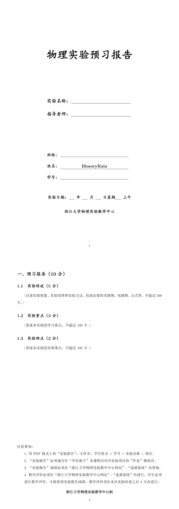

# Physics_Lab_Report
IllusoryRain的大二秋冬（26-27秋冬）的大物实验资料，包括以下内容：

- 改良的大物实验预习实验报告和实验报告的LaTex模版
- 我做的12个实验（2个必做+10个选做）的实验报告的LaTex源码含图片（隐去了实验数据签字图，请自行插入图片）以及Python绘图源码
- 大物实验选课网站上下载的对应实验的课件
- 个人所选实验、指导老师、分数、推荐指数以及评价
- 如要直接下载pdf，可见我个人博客的文章：[大学物理实验](https://illusoryrainzjuisee.github.io/2026/08/24/da-xue-wu-li-shi-yan/)

## 前言

> 大物实验在今年的实验安排上做了一定的变动，如必做实验的第二节课的实验变为二选一（如示波器有声速测定和组装整流器两个可选），一些选做实验的名称进行了修改，有的内容进行了拆分，或者直接取消了这个实验。此外，即使名称未改变的实验，实验内容也可能有所变动，此外不同老师对相同实验的要求也可能不同，因此以下报告内容仅供参考，需根据上课情况灵活变动，不要直接照搬。

## 实验、指导老师、分数以及推荐指数
> 仅为我的主观看法，推荐为一星到五星，五星为最好。

|实验名称|指导老师|分数|推荐指数|
|-|-|-|-|
|交流电路功率因数实验|施博通|93/100|★★★★★|
|用霍尔法测直流圆线圈与亥姆霍兹线圈磁场|郭红丽|94/100|★★★★⯪|
|示波器的使用+组装整流器（必做）|居乐乐|94/100|★★★★⯪|
|分光计的调整和使用+棱镜偏向角特性（必做）|王兆英|95/100|★★★★⯪|
|双棱镜干涉|包泽杭|93/100|★★★⯪☆|
|密立根油滴实验|郭红丽|||
|光电效应测定普朗克常量|史明|||
|迈克尔逊干涉仪的应用|包泽杭|||
|弗兰克赫兹实验|史明|||
|万用表的设计|施博通|||
|直流双臂电桥|王立刚|||
|直流电桥的应用|王立刚|||

## 实验评价

### 交流电路功率因数实验  施博通  93/100

特别简单的实验，可以自己看一下配套课程网站的3分钟演示视频，照做就行，只需要测6个电容的实际电容，以及在45,50,55Hz频率下所加电容从0到7μF的日光灯功率、电压和电流，一共3×8组数据，我四十分钟做完就走了。报告处理起来也很简单，没有误差和不确定度的计算，只需要绘制cosφ与所加电容的关系图即可，总体来说十分推荐。

### 用霍尔法测直流圆线圈与亥姆霍兹线圈磁场  郭红丽  94/100

实验本身不算复杂，但是测量的数据很多，一定要好好听课听清测量要求，我们班的测量要求是只需测正向或者反向磁感应强度即可，但是亥姆霍兹线圈需要测量d=R，d=R/2，d=2R三种情况下的轴向磁场分布，不要学我直接按照原课件的操作多测了好多数据。实验报告也花了很多时间，数据计算特别多，建议丢给ai处理，然后自己再查一遍。总体来说实验还是非常简单的，推荐选。

### 示波器的使用+组装整流器（必做）  居乐乐  94/100

第一节课分为测二极管导通电压+利用RC电路测相位差+李萨如图形测未知信号频率三个实验，实验本身都很简单，因为是必做实验老师讲的也很细，完全跟的上，居乐乐老师也很好，有问题会耐心细致解答，不过为了统一大家实验进度所以这个实验不能很快离开。第二个实验组装整流器也是很简单，面包板不会接线的可以直接跟着实验网站的视频接或者问老师即可，注意半波、全波、桥式的测量误差越来越大这是正常的，实验报告里也需要回答对应思考题，不要怀疑自己的测量结果而捏造数据。另一个必做实验的选择是声速测定，应该也挺简单的，所以选哪个都无所谓。

### 分光计的调整和使用+棱镜偏向角特性（必做）  王兆英  95/100

第一节课花了大量时间讲分光计的调整，这部分一定要好好听，步骤很多，不懂的话可以请教身边同学或者老师。王兆英老师很严格，上课反复强调好好听，讲的也很细致，不过如果你真的一点不会，老师也会很耐心地帮你调节，所以放心问就行。第一节课重点在于调节分光计，调好后测量三棱镜顶角是很快的，这里有个skill，就是关心游标I，II窗和左右位置之间的数据的关联，即有固定的120°和240°的差值，可以帮助你更快的找到光线。第二节课是测量绿光的最小偏向角和三棱镜对汞灯单色光的折射率，后面的实验只要测一次即可，绿光红光蓝光和紫光，这节课首先依旧是调分光计，忘了的最好复习一下，我就因为记反了减半逼近法的调旋钮顺序导致调不好，最后是老师帮忙调的，这个实验还有一个难点就是找光线，要注意三棱镜的摆放位置，以及紫光特别的淡，王兆英老师特地告知了不同光的间距，实验一定要注意，避免找错光，总体来说实验测量并不算难，就是调仪器费时间，找光线费眼睛。

### 双棱镜干涉  包泽杭  93/100

我不太推荐的一个实验，两个人一组，完成二次成像法测D和d和衍射法测红光波长两个实验。这个实验主要难点在于仪器太难调了，要调光源，凸透镜，双棱镜，狭缝等等的等高共轴以及最难的调摄影头成清晰的衍射图像，我们组老师拿来示例才做的比较快，不然这个仪器调好就要很久。数据读取并不麻烦，但是最好先注意一下误差是否过大，注意测量的是红光所以波长大致是多少范围要清楚。实验报告处理也比较麻烦，不确定度太多了，总体来说不推荐，老师的给分也只能说中规中矩，但是光学实验是必做一个的，所以可以斟酌一下。

### 密立根油滴实验  郭红丽

### 光电效应测定普朗克常量  史明

### 迈克尔逊干涉仪的应用  包泽杭

### 弗兰克赫兹实验  史明 

### 万用表的设计  施博通

### 直流双臂电桥  王立刚

### 直流电桥的应用  王立刚

## 实验报告模版预览




## 编译

建议使用XeLaTeX编译，模版使用 `ctexart` 中文文档类，本地编译环境需安装支持中文的TeX发行版（例如TeX Live），或者使用网页版Overleaf进行编译。

## 绘图

各个实验提供了Python绘图源码，可直接修改数据后运行生图（绘图依赖的是Python 3.14.7解释器以及Matplotlib 3.11.2第三方库，请先安装对应解释器和第三方库），图片会自动生成在每个实验文件夹下的figures文件夹（同名文件会覆盖）。

如果你当前使用的是Python 3.14.7解释器，可以在PowerShell中执行：

``` powershell
python -m pip install matplotlib
```

如果不是，也可以这样安装指定版本：

```powershell
python -m pip install matplotlib==3.11.2
```

检查是否安装成功：

``` powershell
python -c "import matplotlib; print(matplotlib.__version__)"
```

如果输出以下即为安装成功：

```powershell
3.11.2
```

如果无法安装，可能是没有安装或升级pip管理工具，通过以下方法解决。

安装命令：

``` powershell
python -m ensurepip --upgrade
```

升级命令：

``` powershell
python -m pip install --upgrade pip
```

验证 pip 是否安装成功:

```powershell
python -m pip --version
```

## License

请不要直接照抄数据，报告内容仅供参考。